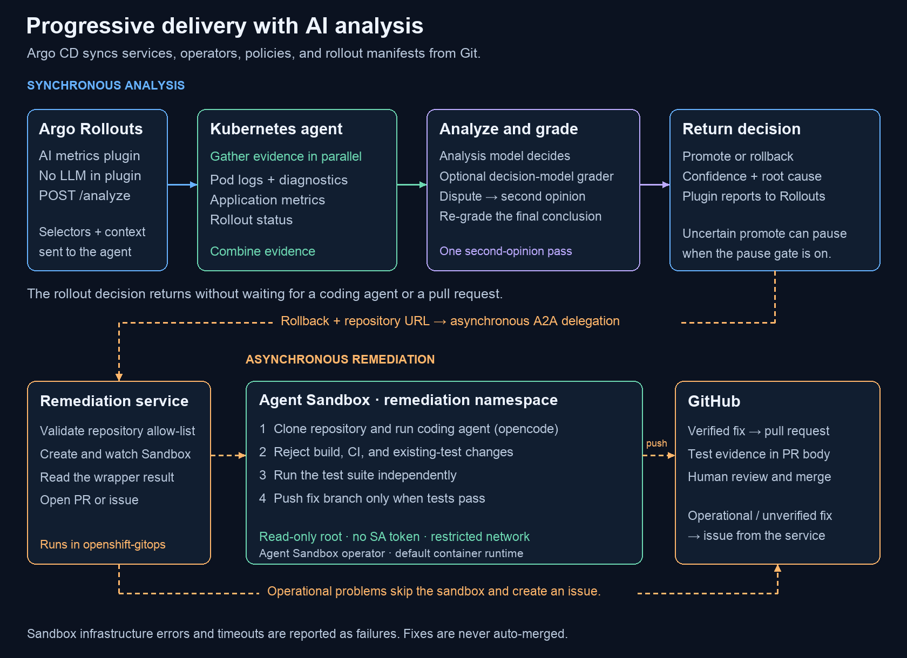
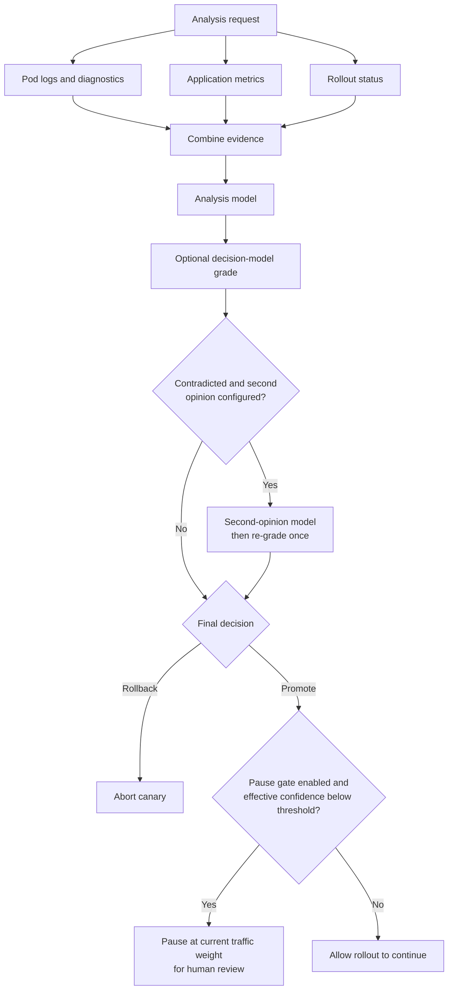
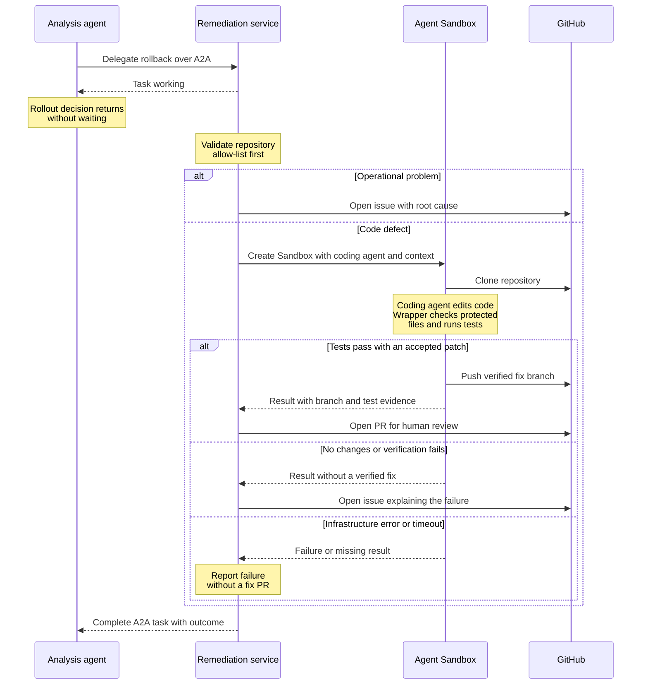
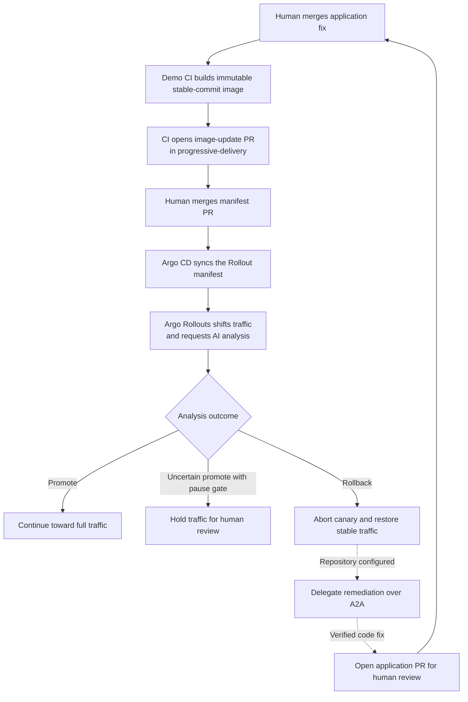

# Progressive delivery with Argo Rollouts and AI-powered analysis

This repository contains the GitOps manifests for AI-assisted canary delivery on OpenShift. Argo CD deploys Argo Rollouts, a stateless AI metrics plugin, a Kubernetes analysis agent, a separate remediation service, and demo workloads. Remediation runs a coding agent inside an Agent Sandbox and opens a pull request only after independent test verification.

The reference cluster has been retired. These manifests describe the deployment configuration, but end-to-end verification requires a new cluster.

For plain Kubernetes, see [Running on vanilla Kubernetes](#running-on-vanilla-kubernetes).

## How it works

Argo Rollouts calls `rollouts-plugin-metric-ai`, which POSTs pod selectors and rollout context to the Kubernetes agent at `/analyze`. The plugin has no LLM. The agent gathers pod diagnostics, application metrics, and rollout status in parallel, combines the evidence, and asks the analysis model for a promote or rollback decision with confidence and root cause.

When `TYPESAFE_API_KEY` is configured, a decision-model grader checks whether the evidence contradicts the conclusion and whether it is sufficient to verify it. A contradicted conclusion can trigger one re-analysis with the second-opinion model, followed by another grade. Thin evidence alone leaves the model's confidence unchanged. The final decision returns synchronously to the plugin while remediation runs asynchronously.

The plugin defaults to automatic decisions, but the Quarkus demo enables the uncertainty pause gate at a confidence threshold of 50. A low-confidence promote, including a promote vetoed by the grader, pauses the rollout for human review. A rollback with a repository URL starts remediation over A2A.



[Editable diagram](full-architecture.svg)

### From evidence to a rollout decision

The evidence collectors run concurrently without an LLM. The analysis model uses their combined report, and the optional grader can request one second opinion over the same evidence. The final decision and effective confidence determine whether the rollout continues, aborts, or pauses.



A missing grader or a neutral grade preserves the model's self-reported confidence. A contradicted final conclusion lowers the effective confidence used by the pause gate. The HTTP response still carries the model's self-reported confidence.

### Remediation in an Agent Sandbox

The remediation service validates the repository against its allow-list before doing any work. Operational problems create a GitHub issue directly. For a code defect, the service creates a `Sandbox` resource (`agents.x-k8s.io/v1beta1`) in the `remediation` namespace and watches its result.

The service owns the A2A task and GitHub PR or issue creation, while the sandbox owns code execution and test verification.



Inside the sandbox, `run-agent.sh` clones the repository and runs the configured coding agent. The reference image uses opencode, with pi and Bob supported by alternative image variants. The wrapper rejects changes to build files, CI configuration, or existing tests, runs the repository's test suite independently, and pushes a fix branch only after the tests pass. The service then opens a PR with the test evidence for human review. Runs with no changes or failed verification create an issue, while infrastructure errors and timeouts are reported as failures. Nothing auto-merges the fix.

The sandbox has a read-only root filesystem, no service-account token, and no Kubernetes permissions. The manifests deny ingress and restrict egress to GitHub, Maven Central, npm, DNS, and configured model endpoints. The default container runtime is used; hardware isolation through Kata or gVisor requires additional cluster support and a sandbox template change.

The namespaces separate the services from the code they execute:

- `openshift-gitops` contains Argo CD, Argo Rollouts and its plugin, the analysis agent, the remediation service, and Vault.
- `quarkus-demo` contains the stable and canary application pods.
- `remediation` contains the sandbox pods and their credentials.
- `agent-sandbox-system` contains the Agent Sandbox operator installation.

## Prerequisites

- OpenShift cluster v4.20 or later
- [Argo Rollouts kubectl plugin](https://argoproj.github.io/argo-rollouts/installation/#kubectl-plugin-installation)
- [JBang](https://www.jbang.dev/) (auto-installed by the bootstrap script if missing)
- An AI API key — OpenAI, Gemini, or any OpenAI-compatible endpoint
- `oc` logged into the target cluster with permission to install operators and cluster-scoped resources
- A GitHub token with permission to push branches, open pull requests, and create issues in the remediation target repository
- An LLM API key for the sandbox coding agent (`LLM_API_KEY` when bootstrapping Vault)

Use a fine-grained token restricted to the target repository with Contents, Pull requests, and Issues write permissions. Bootstrap webhook tuning also needs permission to manage webhooks on the GitOps repository; the bootstrap currently reuses `GITHUB_TOKEN` for this operation.

## Setup

### 1. Fork and configure the repository

Fork this repository, then update both the generator and source `repoURL` fields in the ApplicationSets to point to your fork:

- [`components/applicationsets/system-appset.yaml`](components/applicationsets/system-appset.yaml)
- [`components/applicationsets/workloads-appset.yaml`](components/applicationsets/workloads-appset.yaml)

If using the `existing-argocd` overlay, update its [system ApplicationSet](bootstrap/overlays/existing-argocd/system-appset-existing-argocd.yaml) and [workload ApplicationSet](bootstrap/overlays/existing-argocd/workloads-appset.yaml) too. Its system list currently omits `system/agent-sandbox` and `system/remediation-agent`; add those paths in your fork to deploy remediation.

Update the agent ConfigMap at [`system/kubernetes-agent/configmap.yaml`](system/kubernetes-agent/configmap.yaml) with your model endpoints:

```yaml
data:
  ANALYSIS_BASE_URL: "https://api.openai.com/v1"
  ANALYSIS_MODEL: "gpt-4o"
```

Set `ANALYSIS_SECOND_OPINION_MODEL` and `ANALYSIS_SECOND_OPINION_BASE_URL` in the same ConfigMap if escalation is needed. An empty second-opinion model disables that tier; its API key falls back to the analysis key.

Configure the sandbox model, endpoint, image, coding agent, and `REMEDIATION_ALLOWED_REPOS` in [`system/remediation-agent/remediation-agent.yaml`](system/remediation-agent/remediation-agent.yaml). Match the AnalysisTemplate's `githubUrl` and `baseBranch` to the repository being fixed. The checked-in template and allow-list target the Quarkus demo repository, `kdubois/argo-rollouts-aiops-dashboard`. When using a fork, update both URLs and the demo CI workflow that opens manifest PRs in this repository.

Update the `EgressFirewall` in [`sandbox-namespace.yaml`](system/remediation-agent/sandbox-namespace.yaml) for your LLM endpoint and cluster DNS address. Its checked-in `172.30.0.10/32` DNS rule is cluster-specific. The reference sandbox image includes the demo's Java/Maven toolchain and cached dependencies; other repositories may need a different image and test command.

### 2. Run the bootstrap script

The bootstrap script applies the selected Argo CD resources, then configures Vault with credentials unless `--skip-vault` is set. It prompts for the analysis API key and GitHub token upfront. Export `LLM_API_KEY` before running it to enable the coding agent in sandbox runs.

If the cluster does not already have Argo CD:

```shell
./bootstrap/bootstrap.java
```

(Note: You don't need to have Java installed, this is a [JBang](https://www.jbang.dev/) script that self-installs dependencies)

If the cluster already has a shared `openshift-gitops` Argo CD instance:

```shell
./bootstrap/bootstrap.java --overlay existing-argocd
```

The script runs in this order:

1. Prompt for your AI API key and GitHub token
2. Read the optional `TYPESAFE_API_KEY`, `ANALYSIS_SECOND_OPINION_API_KEY`, and `LLM_API_KEY` from the environment
3. Install OpenShift GitOps and wait for its CRDs (default overlay only)
4. Apply the Argo CD instance (default overlay), AppProjects, and ApplicationSets
5. Tune Argo CD polling and attempt to configure the GitHub webhook
6. (Optionally) Wait for Vault to be ready, then write your credentials and configure Kubernetes auth

Argo CD syncs the system and workloads from Git, including the Vault and Agent Sandbox operators in the default configuration. The existing Argo CD overlay needs the remediation paths added as described above.

#### What gets deployed

- HashiCorp Vault and Vault Secrets Operator to sync credentials into the agent and sandbox namespaces
- Argo Rollouts with the AI metrics plugin
- Kubernetes agent for AI-powered canary analysis, with the decision-model grader and second opinion escalation
- Red Hat build of Agent Sandbox operator, the remediation service, and the isolated sandbox namespace
- Quarkus demo application with canary analysis and an activity dashboard, plus the alternate `canary-app` demo
- A pinned remote `wind-turbine-live` workload, selected by the `workloads/*` ApplicationSet generator; remove or adapt it in your fork if it is not needed

#### Managing secrets without Vault

The `--skip-vault` flag skips credential bootstrapping only; it does not remove Vault resources from the ApplicationSets. To run without Vault, also remove the Vault application paths and Vault custom resources from the relevant Kustomizations in your fork, including `system/remediation-agent/vault-secrets.yaml`. Otherwise the Vault Secrets Operator can overwrite manually managed secrets.

Then run:

```shell
./bootstrap/bootstrap.java --skip-vault
```

Then apply credentials manually:

```shell
cp system/kubernetes-agent/secret.yaml.template system/kubernetes-agent/secret.yaml
# fill in your credentials
oc apply -f system/kubernetes-agent/secret.yaml
```

The template expects:

```yaml
stringData:
  analysis_api_key: sk-...                    # required - analysis tier
  analysis_second_opinion_api_key: ...        # optional - escalation tier (falls back to the analysis key)
  typesafe_api_key: ...                       # optional - decision-model key for the grader
```

Create a `remediation-agent` Secret in both `openshift-gitops` and `remediation`, each with `github_token` and `llm_api_key`. The service uses the token to create PRs and issues, and the sandbox needs both keys to run the coding agent and push the branch. Keep secret files outside Git. With Vault enabled, [`vault-secrets.yaml`](system/remediation-agent/vault-secrets.yaml) syncs the same credentials to both namespaces.

> `secret.yaml` is git-ignored and never managed by GitOps.

#### Re-running the Vault bootstrap

Vault runs in dev mode with in-memory storage. If the Vault pod restarts, credentials are lost. Re-run the credential setup (this also runs Argo CD sync tuning):

```shell
./bootstrap/bootstrap.java --vault-only
```

Credentials can also be passed via environment variables to skip the prompts:

```shell
ANALYSIS_API_KEY=sk-... GITHUB_TOKEN=ghp_... LLM_API_KEY=... ./bootstrap/bootstrap.java
```

### Argo CD sync tuning (bootstrap)

The bootstrap also tunes Argo CD sync latency for live demos: the git poll
interval drops to 15s (the application controller restarts to pick it up),
and a GitHub webhook on this repository triggers instant syncs on push. Both
are per-cluster state. The bootstrap repoints an existing webhook at the new
cluster when the cluster changes. A stale webhook can remain enabled in GitHub
while its deliveries fail. Set `GITHUB_REPO` when bootstrapping a fork.

### 3. Verify the deployment

Argo CD will take a few minutes to sync everything. Once it's done:

```shell
# Argo Rollouts controller
oc get pods -n openshift-gitops | grep argo-rollouts

# Kubernetes agent
oc get pods -n openshift-gitops | grep kubernetes-agent

# Remediation service and sandbox controller
oc get pods -n openshift-gitops -l app=remediation-agent
oc get pods -n agent-sandbox-system
oc get crd sandboxes.agents.x-k8s.io
oc get secret remediation-agent -n remediation

# Agent health check
oc port-forward -n openshift-gitops svc/kubernetes-agent 8080:8080 &
curl http://localhost:8080/q/health

# Confirm the plugin loaded
oc logs deployment/argo-rollouts -n openshift-gitops | grep -i "download.*metric-ai"
```

If the plugin does not load on first deployment, check the controller logs and the [plugin troubleshooting steps](#plugin-not-loading).

### 4. Access the application

```shell
export APP_URL=$(oc get route quarkus-demo -n quarkus-demo -o jsonpath='{.spec.host}')
open https://$APP_URL
```
You should see the sample Quarkus application dashboard showing the current deployment status and rollout information.

## Testing progressive delivery

### From a code fix to a new canary

Application code and deployment manifests live in separate repositories. Merging a fix starts the demo's image build, but deployment waits for the generated manifest PR to be merged too. Argo CD then syncs the image change and Argo Rollouts evaluates the new canary.



### Trigger a rollout

Edit the image tag in [`workloads/quarkus-rollouts-demo/base/rollout.yaml`](workloads/quarkus-rollouts-demo/base/rollout.yaml), commit, and push. Argo CD detects the change and starts the rollout.

The ApplicationSet deploys `workloads/quarkus-rollouts-demo/` directly, so editing the scenario overlays does not change the deployed rollout. The base manifest keeps one image line active and the other scenario tags commented. To switch, comment the current line and uncomment the target one:

```shell
# workloads/quarkus-rollouts-demo/base/rollout.yaml
# Comment the currently active stable-<commit> image line, then enable:
image: ghcr.io/kdubois/argo-rollouts-quarkus-demo:v2.nullpointer
```

```shell
git add .
git commit -m "demo: run the null pointer scenario"
git push
```

Do not use `kubectl set image`: Argo CD reconciles the manifest back.

```shell
oc argo rollouts get rollout quarkus-demo -n quarkus-demo --watch
```

The demo uses background analysis with two measurements, a 5-second initial delay, and a 30-second interval. The rollout pauses for 10 seconds and then 30 seconds at 10% traffic, followed by 90 seconds at 60%, to give those measurements time to finish. A failed measurement aborts the rollout (`failureLimit: 0`). Background analysis does not block the 100% step indefinitely, so keep the pauses long enough for your chosen models. The grader and second-opinion tier run when configured.

The demo's CI also builds an immutable `stable-<commit>` image on pushes to its main branch and opens a PR here to update the active image line. After a human merges a remediation PR, that build and manifest PR can deliver the fix through another canary rollout.

```shell
# List analysis runs
oc get analysisrun -n quarkus-demo

# Inspect a run
oc get analysisrun <name> -n quarkus-demo -o yaml
```

### Test auto-rollback

The sample application ships several pre-built images with injected failure modes (null pointer exceptions, memory leaks, progressive latency drift). Point the rollout at one of them to see the agent detect the problem and abort:

```shell
vim workloads/quarkus-rollouts-demo/base/rollout.yaml
git add . && git commit -m "test: trigger rollback scenario" && git push
oc argo rollouts get rollout quarkus-demo -n quarkus-demo --watch
```

To recover, revert the image tag and push, or retry manually:

```shell
oc argo rollouts retry rollout quarkus-demo -n quarkus-demo
```

## Configuration

### Change models through GitOps

Edit [`system/kubernetes-agent/configmap.yaml`](system/kubernetes-agent/configmap.yaml) for analysis and second-opinion models. Edit the ConfigMap in [`system/remediation-agent/remediation-agent.yaml`](system/remediation-agent/remediation-agent.yaml) for the sandbox model and coding agent. Commit and push the changes, let Argo CD sync, then restart the affected service so it reads the new environment:

```shell
oc rollout restart deployment/kubernetes-agent -n openshift-gitops
oc rollout restart deployment/remediation-agent -n openshift-gitops
```

When changing the sandbox LLM endpoint, update its egress allow-list in Git too.

### Custom analysis prompts

Add application-specific context to the AnalysisTemplate at [`workloads/quarkus-rollouts-demo/base/analysistemplate-ai-agent.yaml`](workloads/quarkus-rollouts-demo/base/analysistemplate-ai-agent.yaml):

```yaml
argoproj-labs/metric-ai:
  agentUrl: http://kubernetes-agent:8080
  extraPrompt: |
    This is a payment processing service.
    Ignore transient network errors during startup.
    Abort on any transaction failure or database connection error.
```

### Pause on uncertainty

The plugin's pause gate is off by default, and the Quarkus demo enables it in its AnalysisTemplate. Enable the pause gate to hold the rollout for human review whenever the analysis promotes with confidence below a threshold:

```yaml
argoproj-labs/metric-ai:
  agentUrl: http://kubernetes-agent:8080
  pauseOnUncertainty: true
  uncertaintyThreshold: 50
```

The agent patches the Rollout's `spec.paused`, so the rollout holds its current canary weight while a human decides. The measurement stays successful while the pause holds the rollout. Resume with `oc argo rollouts promote quarkus-demo -n quarkus-demo` or abort manually. The paused rollout name is stored in the measurement's `pausedRollout` metadata field.

The gate uses the effective confidence, not just the model's self-report. After each analysis the decision-model grader checks the conclusion against the evidence: a contradicted promote escalates to the second opinion model, and if the grade stays below the veto bar the rollout is paused. A `neutral` grade (evidence too thin to verify) keeps the self-reported confidence, so an early canary sample does not pause a healthy rollout. The dashboard shows both numbers and the grade in the activity feed.

While the rollout is paused, later measurements do not re-patch it or re-publish the event. If a human promotes and the next analysis is still below the threshold, the rollout is paused again because each measurement applies the gate policy.

The patch permission is scoped by a Role in the `quarkus-demo` namespace ([`workloads/quarkus-rollouts-demo/base/rbac.yaml`](workloads/quarkus-rollouts-demo/base/rbac.yaml)); the agent stays read-only everywhere else.

## Troubleshooting

### Plugin not loading

If rollouts fail with "plugin argoproj-labs/metric-ai not configured in configmap", this is a known timing bug in the OpenShift GitOps RolloutManager operator. Restart the controller to fix it:

```shell
oc delete pod -n openshift-gitops -l app.kubernetes.io/name=argo-rollouts
oc wait --for=condition=ready pod -n openshift-gitops -l app.kubernetes.io/name=argo-rollouts --timeout=60s
oc argo rollouts retry rollout quarkus-demo -n quarkus-demo
```

### Agent not starting

```shell
oc logs deployment/kubernetes-agent -n openshift-gitops

# Verify the secret exists (synced from Vault by VSO)
oc get secret kubernetes-agent -n openshift-gitops

# If the secret is missing, check VSO sync status
oc describe vaultstaticsecret kubernetes-agent-secret -n openshift-gitops
oc logs deployment/vault-secrets-operator-controller-manager -n openshift-operators | tail -20
```

### Analysis failures

```shell
# Check pod labels match the selectors in the AnalysisTemplate
oc get pods -n quarkus-demo --show-labels

# Check agent logs for errors
oc logs deployment/kubernetes-agent -n openshift-gitops | grep -i "fetching logs\|auth\|api key"
```

### Remediation failures

```shell
oc logs deployment/remediation-agent -n openshift-gitops
oc get sandboxes.agents.x-k8s.io,pods -n remediation
oc get secret remediation-agent -n openshift-gitops
oc get secret remediation-agent -n remediation
oc logs -n remediation <sandbox-pod>
```

Check that the operator installed the Sandbox CRD, the repository matches `REMEDIATION_ALLOWED_REPOS`, and the sandbox can reach its model endpoint and GitHub. Verify the token has permissions for issues as well as branches and PRs. The checked-in configuration retains failed sandbox runs that produced readable results (`REMEDIATION_SANDBOX_KEEP_FAILED: "true"`), while successful runs are deleted. Timeouts and runs with unreadable results are cleaned up as well.

### Enable debug logging

Add `QUARKUS_LOG_LEVEL: DEBUG` to the agent ConfigMap in Git, sync, and restart the deployment. Configure the Rollouts controller's logging through its managed configuration too, so Argo CD does not revert a direct deployment edit.

## Running on vanilla Kubernetes

The bootstrap script and manifests target OpenShift. The following components need to be adapted for a plain Kubernetes cluster:

- Install Argo CD and Argo Rollouts with their upstream operators or Helm charts instead of the OpenShift subscriptions and `RolloutManager` resource.
- Install the upstream Agent Sandbox controller instead of the Red Hat operator subscription, and ensure the `sandboxes.agents.x-k8s.io` CRD exists before starting remediation.
- Replace OpenShift Routes and the OpenShift traffic-router plugin with an ingress or Gateway API integration supported by Argo Rollouts.
- Install Vault Secrets Operator with Helm, or remove the Vault integration and manage plain Secrets as described above.
- Replace the OpenShift `EgressFirewall` with a DNS-aware egress policy supported by the cluster network, and adapt the DNS allow rule to the cluster.

The service deployments, AnalysisTemplates, and Sandbox resources can then use the corresponding upstream controllers. If renaming namespaces, update service URLs, RBAC bindings, Vault authentication, and sandbox configuration together. The [remediation service's standalone manifests](https://github.com/kdubois/remediation-agent/tree/main/deployment) provide a plain Kubernetes starting point.

## Additional resources

- [Argo Rollouts plugin README](https://github.com/kdubois/rollouts-plugin-metric-ai)
- [Kubernetes agent README](https://github.com/kdubois/kubernetes-aiops-agent)
- [Remediation agent README](https://github.com/kdubois/remediation-agent)
- [Quarkus demo README](https://github.com/kdubois/argo-rollouts-aiops-dashboard)
- [Agent Sandbox](https://github.com/kubernetes-sigs/agent-sandbox)
- [Argo Rollouts documentation](https://argoproj.github.io/argo-rollouts/)
- [OpenShift GitOps documentation](https://docs.openshift.com/gitops/)

